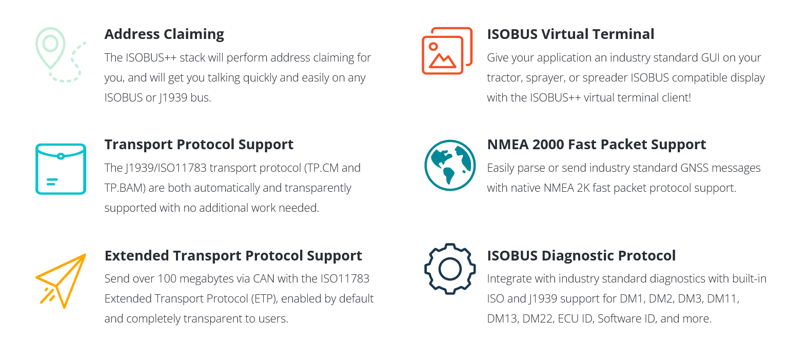
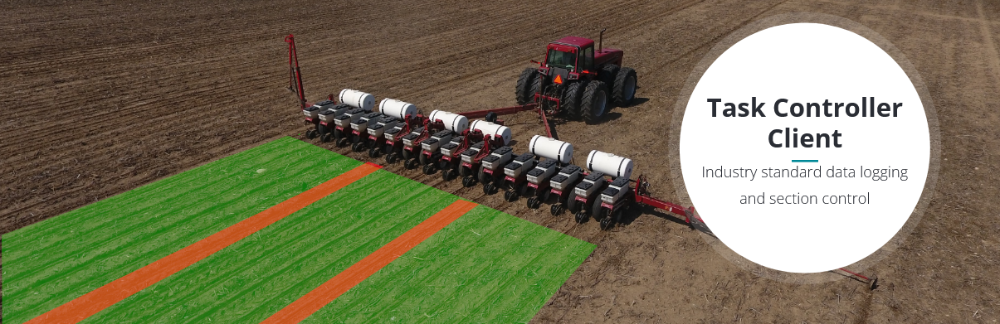
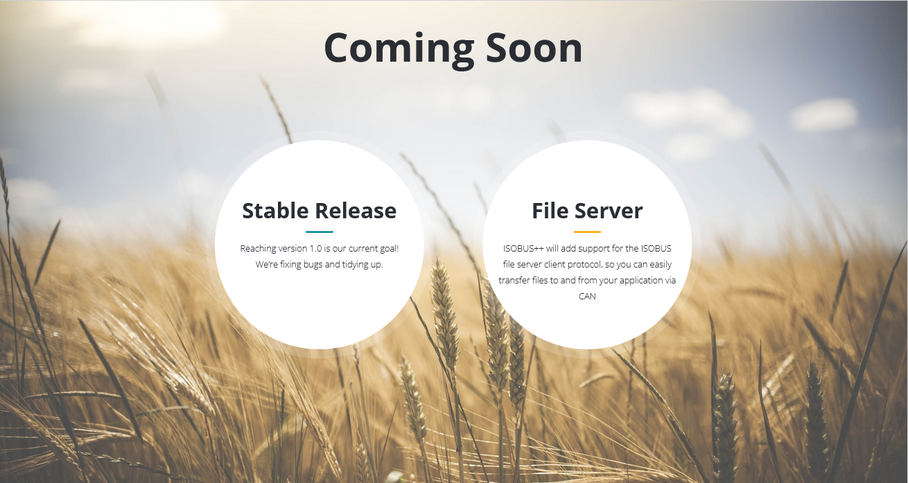

<div align="center">

# AgIsoStack++ 🚜

— <ins>**Ag**</ins>riculture <ins>**ISO**</ins>-11783 <ins>**stack**</ins> for C<ins>**++**</ins>

*The completely free open-source ISOBUS library for everyone - from hobbyists to industry!*

[Documentation & Tutorials](https://agisostack-plus-plus.readthedocs.io/en/latest/index.html) | [Issues & Suggestions](https://github.com/Open-Agriculture/AgIsoStack-plus-plus/issues) | [Discussions](https://github.com/Open-Agriculture/AgIsoStack-plus-plus/discussions) | [Discord](https://discord.gg/uU2XMVUD4b) | [Telegram](https://t.me/+kzd4-9Je5bo1ZDg6)

[](https://github.com/Open-Agriculture/AgIsoStack-plus-plus/actions/workflows/build.yml)
[](https://github.com/Open-Agriculture/AgIsoStack-plus-plus/commits/main)
[](https://github.com/Open-Agriculture/AgIsoStack-plus-plus/blob/main/LICENSE)
[](https://sonarcloud.io/summary/new_code?id=ad3154_ISO11783-CAN-Stack)
[](https://sonarcloud.io/summary/new_code?id=ad3154_ISO11783-CAN-Stack)
[](CITATION.cff)

</div>






> AgIsoStack++ simplifies implementing ISOBUS functionalities by providing a transparent and well-documented library. This allows you to concentrate on your application, without getting bogged down in rules defined by standards and guidelines.

- [Features](#features)
- [In Detail](#in-detail)
- [Getting Started](#getting-started)
- [Repository Layout](#repository-layout)
- [Contributing](#contributing)
- [Related Projects](#related-projects)
- [Roadmap](#roadmap)
- [Community](#community)

## Features

- Platform independent C++11 library, from Linux, Windows and macOS PCs down to ESP32 microcontrollers
- The complete backbone of the ISO11783 and J1939 standards: address claiming, transport protocol (TP), extended transport protocol (ETP) and PGN requests
- Virtual Terminal Client (Universal Terminal), plus a Virtual Terminal Server base
- Auxiliary control (AUX-N)
- Task Controller Client and Server, with a Device Descriptor Object Pool (DDOP) builder
- ISOBUS shortcut button (ISB)
- Diagnostic protocol (DM1, DM2, DM3, DM11, DM13, DM22, ECU and software identification)
- Control function functionalities, heartbeat, language command, maintain power and time/date messages
- Common guidance and speed messages (wheel-based, ground-based and machine selected speed)
- NMEA 2000 Fast Packet Protocol and common NMEA 2000 messages
- [Hardware drivers for many common CAN controllers](https://agisostack-plus-plus.readthedocs.io/en/latest/api/hardware/index.html#choosing-a-can-driver-with-cmake), and a virtual CAN driver for testing without hardware

## In Detail

ISOBUS (based on the ISO-11783 standard) defines how agricultural machinery should communicate with each other on a CANbus network. Cross compatibility is achieved when different manufacturers carefully follow this standard when developing their devices. This means that a tractor from one manufacturer can communicate with an implement from another manufacturer, and vice versa.

AgIsoStack++ provides an easy-to-use interface for your application to communicate on the ISOBUS network in a compliant manner, without the need to worry about the details of the standard.
The library is written in C++11 and uses the STL whenever possible. It is designed to be easy to understand and is fully documented.

## Getting Started

Check out the [tutorial website](https://agisostack-plus-plus.readthedocs.io/en/latest/) for information on ISOBUS basics, how to download this library, and how to use it. The tutorials contain in-depth examples and explanations to help get your ISOBUS or J1939 project going quickly. A good first stop is [The ISOBUS Hello World](https://agisostack-plus-plus.readthedocs.io/en/latest/Tutorials/The%20ISOBUS%20Hello%20World.html).

### Using the library in your project

The library is built from source with CMake 3.16 or newer. The quickest way to pull it into a CMake project is `FetchContent`:

```cmake
include(FetchContent)
FetchContent_Declare(
  AgIsoStack
  GIT_REPOSITORY https://github.com/Open-Agriculture/AgIsoStack-plus-plus.git
  GIT_TAG        main # Pin a commit hash for reproducible builds
)
FetchContent_MakeAvailable(AgIsoStack)

find_package(Threads)
target_link_libraries(<your target> PRIVATE isobus::Isobus isobus::HardwareIntegration isobus::Utility Threads::Threads)
```

A CAN driver is picked for your OS by default (SocketCAN on Linux, PEAK PCAN-Basic on Windows, MacCAN PCAN on macOS). Choose another with `-DCAN_DRIVER=<driver>`, or several with `-DCAN_DRIVER="<driver1>;<driver2>"`. The [installation guide](https://agisostack-plus-plus.readthedocs.io/en/latest/Installation.html) also covers git submodules, and the [ESP32 PlatformIO tutorial](https://agisostack-plus-plus.readthedocs.io/en/latest/Tutorials/ESP32%20PlatformIO.html) covers microcontrollers.

### Building the examples and tests

```bash
git clone https://github.com/Open-Agriculture/AgIsoStack-plus-plus.git
cd AgIsoStack-plus-plus
cmake -S . -B build -DBUILD_EXAMPLES=ON -DBUILD_TESTING=ON
cmake --build build --config Debug
cd build && ctest -C Debug --output-on-failure
```

The library itself is C++11, but the unit tests need a C++17 compiler.

On Linux, examples that use the default SocketCAN driver open the `vcan0` interface, so you can try them without any CAN hardware:

```bash
sudo modprobe vcan
sudo ip link add vcan0 type vcan
sudo ip link set vcan0 up
```

See [examples/README.md](https://github.com/Open-Agriculture/AgIsoStack-plus-plus/blob/main/examples/README.md) for installing the library as a CMake package and building a single example against it.

### Use of our SAE/ISOBUS Manufacturer Code

If you are integrating with our library to create an ISO11783 or J1939 application and are not selling your software or device containing that software for-profit, then you are welcome to use our manufacturer number in your application.

If you are creating such an application for sale as a for-profit company, then we ask that you please obtain your own manufacturer code from SAE instead of using ours.

Our manufacturer code is 1407 (decimal).

## Repository Layout

| Directory | Contents |
| --- | --- |
| [isobus/](isobus/) | The protocol stack: network manager, control functions, transport protocols and the application interfaces (VT, TC, diagnostics, ...) |
| [hardware_integration/](hardware_integration/) | `CANHardwareInterface` and the CAN driver plugins |
| [utility/](utility/) | Dependency-free helpers used by the rest of the library (event dispatcher, timing, IOP file parsing, ...) |
| [examples/](examples/) | Example applications demonstrating library features |
| [test/](test/) | GoogleTest unit tests |
| [sphinx/](sphinx/) | Source of the documentation website |

## Contributing

Contributions are welcome! Read [CONTRIBUTING.md](https://github.com/Open-Agriculture/AgIsoStack-plus-plus/blob/main/CONTRIBUTING.md) for the code style, formatting and testing rules a pull request has to meet. It also explains how to install `docs/pre-commit-hook.sh`, which formats your changes before each commit.

## Related Projects

These Open-Agriculture projects are built with, or alongside, AgIsoStack++:

- [AgIsoVirtualTerminal](https://github.com/Open-Agriculture/AgIsoVirtualTerminal) - an ISO 11783-6 Virtual Terminal server for the desktop
- [AgIsoDDOPGenerator](https://github.com/Open-Agriculture/AgIsoDDOPGenerator) - a desktop editor for Device Descriptor Object Pools
- [AgIsoTerminalDesigner](https://github.com/Open-Agriculture/AgIsoTerminalDesigner) - an editor for Virtual Terminal object pools
- [AgIsoStack-rs](https://github.com/Open-Agriculture/AgIsoStack-rs) - a Rust implementation of the stack

## Roadmap



## Community

Join us on [Discord](https://discord.gg/uU2XMVUD4b) for support, to share your project, and good vibes in general! Alternatively, you can also join us on [Telegram](https://t.me/+kzd4-9Je5bo1ZDg6).

## Special Thanks

This project's sponsors are a big part of making this project successful. Their support helps fund new hardware and software tools to test against, which drives up quality.

Thank you:

- Franz Höpfinger [franz-ms-muc](https://github.com/franz-ms-muc)
- Balázs Gunics [gunicsba](https://github.com/gunicsba)
